<p align="center">
  
</p>

<h1 align="center">MangaVox</h1>

<p align="center">
  A fast, native desktop app to read manga, watch anime, movies and series, and turn manga chapters into narrated recap videos for YouTube.
  <br>
  <a href="https://github.com/memegyanfactory-gif/mangavox/releases/latest"><b>Download for Windows</b></a>
</p>

---

MangaVox is written in Rust with the GPUI toolkit. It is a native app with no Electron and no web view for its interface. It starts quickly, stays light on memory and scrolls smoothly through long chapters and large libraries.

It has two halves in one window:

- **Reader and media**: browse, read, download and track manga; watch anime, movies and series with a built-in player.
- **AI Studio** (optional): a full manga-to-YouTube workshop. It reads a chapter, writes a recap script, narrates it, scores it, renders the video, lets you edit it on a timeline, designs thumbnails, finds what to recap next and schedules uploads to your channel.

**Contents:** [Manga](#manga) · [Anime, movies and series](#anime-movies-and-series) · [AI Studio](#ai-studio) · [AI providers](#ai-providers) · [Install](#install) · [Build from source](#build-from-source) · [Acknowledgements](#acknowledgements)

## Manga

Popular, Latest and **For you** feeds per source, and one search across every source you have installed. A title page shows details, tags, "more like this" / "not for me" taste buttons, recommendations picked for your taste, and the chapter list merged across all your sources.

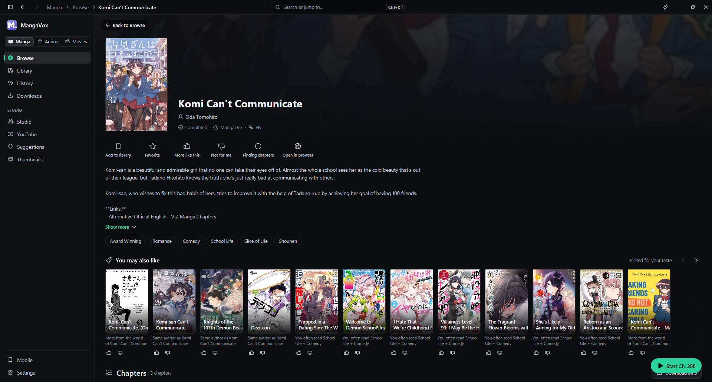

The **Library** keeps your titles with unread and downloaded counts, filters (Unread, Downloaded, Favorites, Ongoing, Completed) and one-click updates.

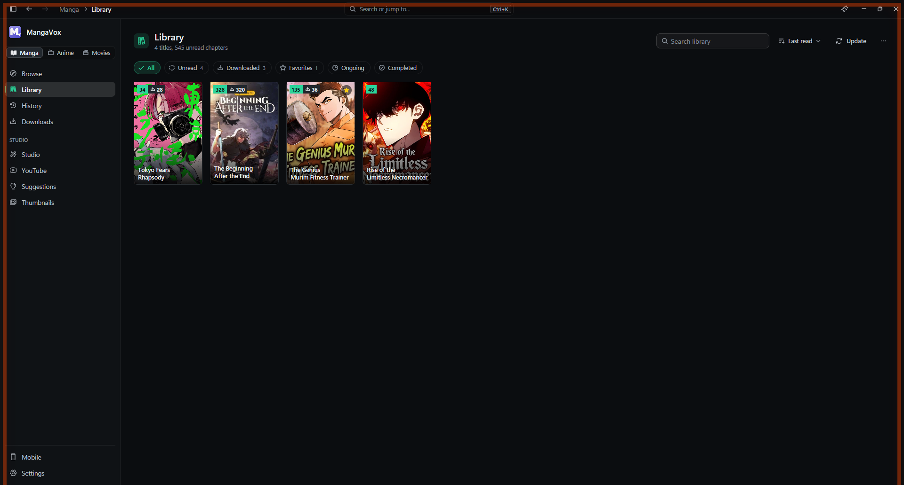

- Chapters for the same title are merged across your sources under the best available name, so a chapter missing from one source is filled in from another.
- Chapter language filter (English, Spanish, Portuguese, French, Indonesian, Russian, Japanese or all), with a fallback to every language when a title has none in yours.
- History, favorites and offline chapter downloads.
- **Smart bypass**: when a site shows an anti-bot check, MangaVox passes it in a hidden built-in browser and loads the page again. It is on by default and can be switched off.

## Anime, movies and series

Home pages with featured titles, Continue Watching, top airing and top 10 lists, genres, artwork and trailers, plus a built-in player (libmpv) with subtitles and history. Streams come from the addons you install.

| Anime | Movies |
|---|---|
| 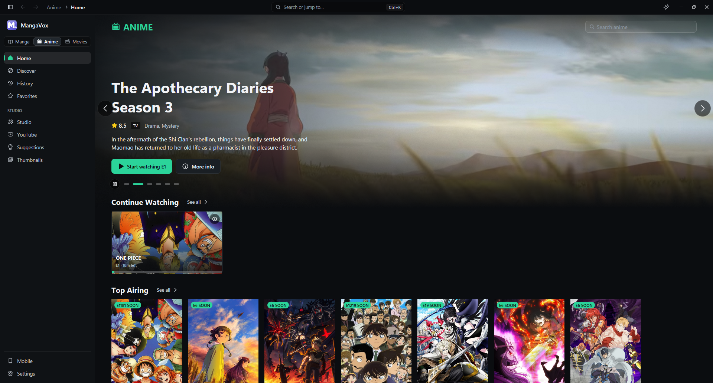 | 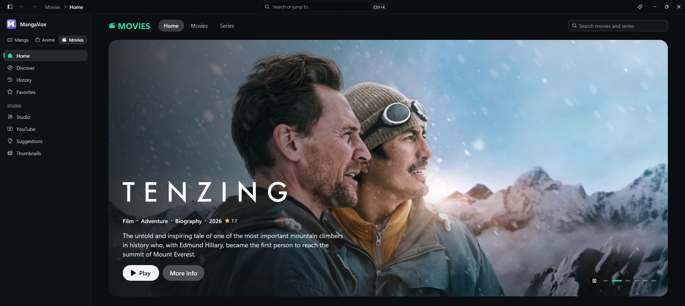 |

The Series page has a Top 10 for today and rows by mood and genre. Open any title for its details, cast and season-by-season episode list.

<table>
  <tr>
    <td width="62%">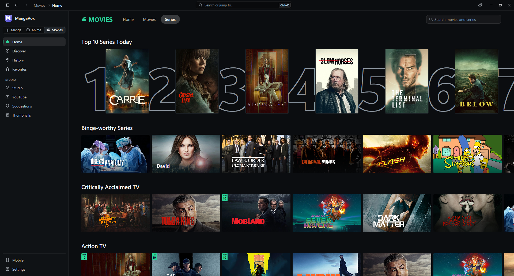</td>
    <td width="38%"></td>
  </tr>
</table>

## Sources, plugins and addons

**MangaVox ships empty.** A fresh install has no source, repository, plugin or addon installed or switched on. Browse stays empty until you add something yourself.

You can install whatever plugins, extensions, repositories and addons you choose:

- **Manga**: extension repositories in the Mihon / Tachiyomi format, single plugins from a GitHub or `manifest.json` link, and a few built-in site readers that stay hidden until you open them in Settings.
- **Movies, series and anime**: any Stremio-compatible addon, from a `manifest.json` or `stremio://` link.

Everything you install shows up right away, and you can remove any of it again from **Settings → Manga sources** or **Settings → Streaming addons**. Plugins run in a sandbox with memory and time limits.

MangaVox does not host, provide or recommend any content. You decide what to install, and you are responsible for using it in line with the laws of your country and the terms of the sites involved.

## AI Studio

Turn on **Settings → App mode → Studio mode** to add the **Studio** section to the sidebar: **Studio**, **YouTube**, **Suggestions** and **Thumbnails**. The Studio page itself has three views, **Dashboard**, **Editor** and **Video**, and a side panel with **Activity**, **Issues**, **Cast** and **Chat**.

The screenshots below are real projects in progress.

### Dashboard

**Your recaps** shows every manga you have downloaded as a cover card with how many of its chapters are made, and how many are waiting in the queue.

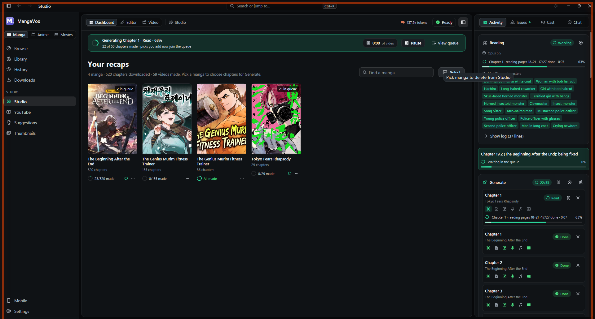

Open a manga to see its chapters as numbered tiles (Not started, In progress, Failed, Done). Click a tile, Shift-click for a range, then press **Generate**. Above the chapters sit:

- **Full recap video**: join every made chapter into one video, a set of parts, or 1-minute vertical reels, in source, 4K, 1440p, 1080p or 720p, with an optional hook and music.
- **YouTube package**: **Research YouTube** finds the recaps of this manga already on YouTube, **Suggest with AI** writes a title, description and thumbnail concept, and **Make thumbnails** opens the thumbnail creator.

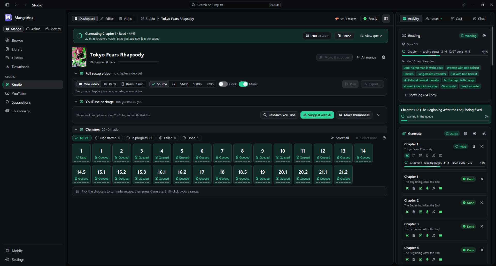

### Generate and the queue

**Generate** asks once for the narrator voice, Landscape or Reels, subtitles and music (it remembers your answers), then runs each chapter through the whole pipeline:

**Read → Transcript → Story → Audio → Music → Video**

The banner on the Dashboard and the **Activity** tab show the queue live: which chapter is working, which step it is on, pages read, characters met, tokens used and time left. You can pause or stop the queue, remove a chapter, or **Redo from** any step. Picks you make while it runs join the queue. Anything that fails lands in **Issues** with a button to fix it.

### Editor

The Editor opens one chapter with a tab for each step. Every step can be checked, edited and made again on its own.

1. **Read**: a vision model reads every page, transcribes the balloons in reading order, recognizes characters by face (it keeps a character memory across chapters, shown in **Cast**) and tags each scene's mood. Several pages are read at once.
2. **Transcript**: edit the text page by page, or ask the AI about a page.
3. **Story**: the AI turns what it read into a recap script in your channel's style. Pick a feel (Happy, Warm, Cinematic, Classic, Old-timer, Hard, Soft and more) or let it follow each scene, and pick the model.
4. **Audio**: local text-to-speech narration. Kokoro is the default (GPU-accelerated when available); Chatterbox acts out each scene with real intensity; Piper is the lightweight option.
5. **Music**: a soundtrack scored to the story, timed and ducked under the narration.
6. **Video**: 16:9 Landscape or 9:16 Reels, 720p to 4K, and a **Look & branding** preset (Clean, Cinematic, Recap duo, Dynamic) with effects such as colour grade, glow, action punch, light leaks, RGB split and parallax, plus your logo. Rendered with FFmpeg; clips render in parallel and are joined into one video.

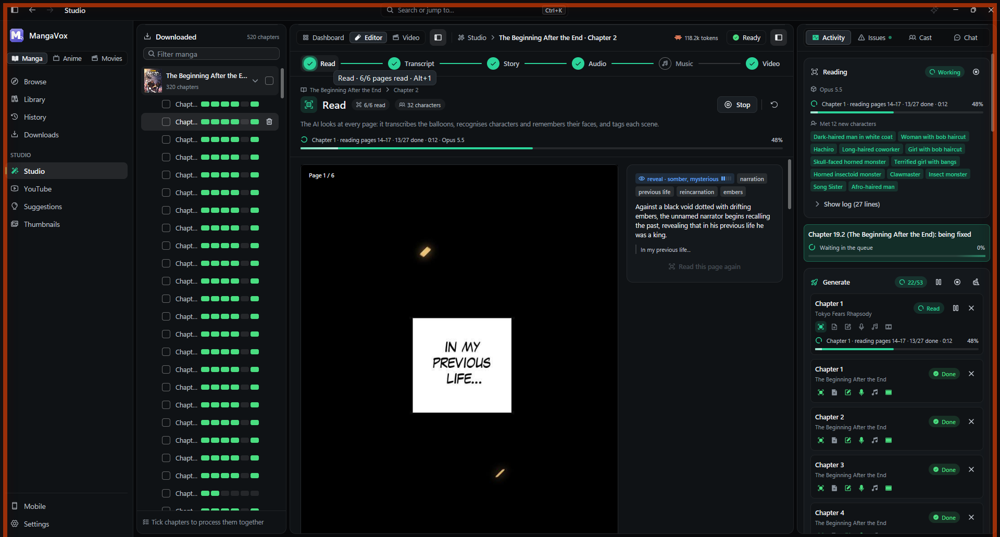

| Story | Video step: look and branding |
|---|---|
| 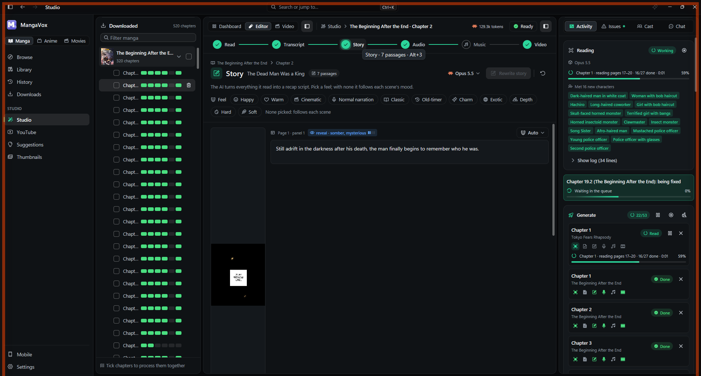 | 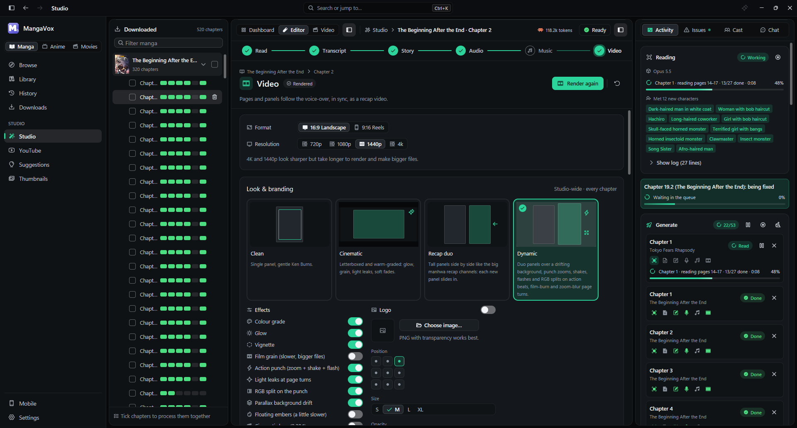 |

### Video editor

The **Video** view is a Premiere-style editor for a manga's finished recaps. It has **Import**, **Edit** and **Export** workspaces, Effect Controls, a live Program monitor, the Project bin with one sequence per chapter, and a timeline with captions (V3), your text and image layers (V2), panels (V1), narration (A1) and music (A2). Trim, split, move and snap clips, add text, image and logo layers, change the caption style (Recap Bold, Beast Box, Lower Third, Manga Bubble, Anime Sub, Speed Rush and more), music and look, then **Render chapter**. **All chapters** lays every chapter end to end, and **Re-edit full timeline** remakes them all with the current settings.

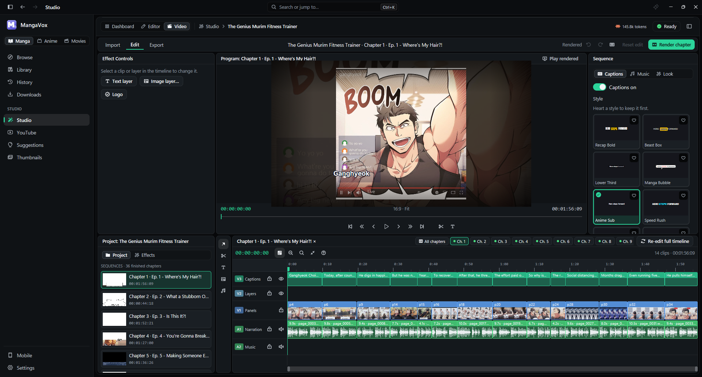

### Thumbnails

A thumbnail generator per manga, built on Magnific's image API. Pick a model (Google Nano Banana, GPT, Seedream, Flux and others), attach the manga's character face cards as references and call them with `@Name` in the prompt. **AI ideas** writes thumbnail concepts for you, and **Thumbnail rules** shows the click checklist that every creation is scored against (learned from what gets clicked on manga and manhwa recap channels). Every image is saved and can be designed again. Magnific API calls use credits from your Magnific account.

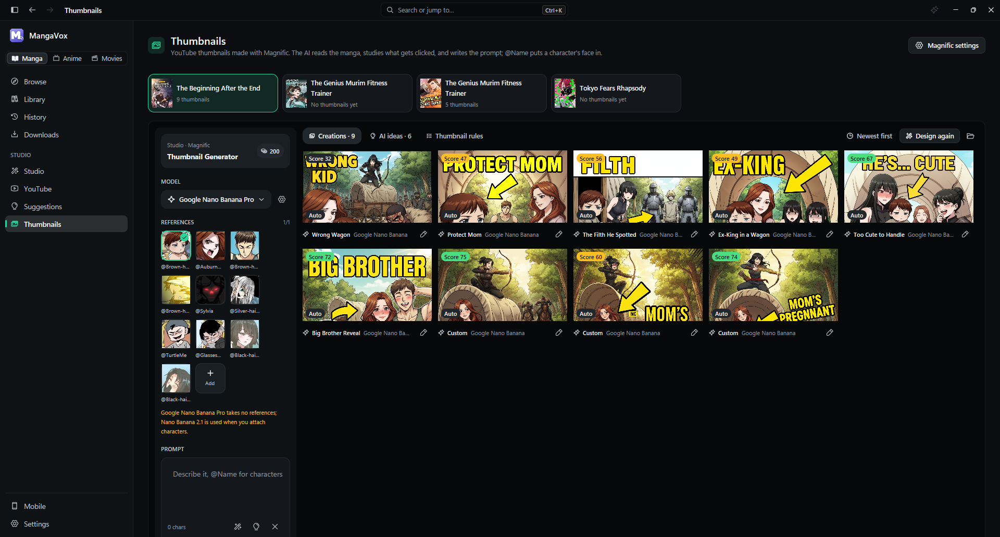

### Suggestions

What manga recap viewers watch right now, and what to recap next.

- **Channel meter**: scores your channel out of 100 on profile, videos, consistency, performance and niche & titles, and lists the fixes worth the most first.
- **Best picks**, **Fastest growing** and **New & rising**: manga being recapped on YouTube ranked by views per day, growth this week and how few channels cover them, with the recaps already out there. Each manga is looked up in your installed sources so it opens like it does from Browse: read, download, send to Studio.

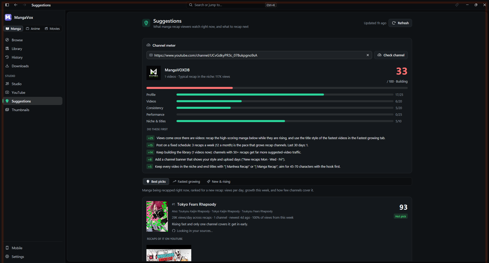

### YouTube

A YouTube Studio for your channel inside MangaVox, with **Dashboard**, **Content**, **Schedule**, **Analytics**, **Insights** and **Settings**.

- Connect your channel once with your own free Google OAuth client (YouTube Data API v3 and YouTube Analytics API). The client secret stays on your PC.
- Upload finished recaps and schedule them in chapter order with a release plan: how often, release time (with a "golden time" hint), visibility, category and series playlists.
- An SEO editor for title, description, tags and release time, with AI-written titles, descriptions and hashtags.
- Smart upload: when a video dips (you set the sensitivity), the next episode is pulled forward.
- **Growth chat**: ask the assistant for titles, ideas and next steps while you work.

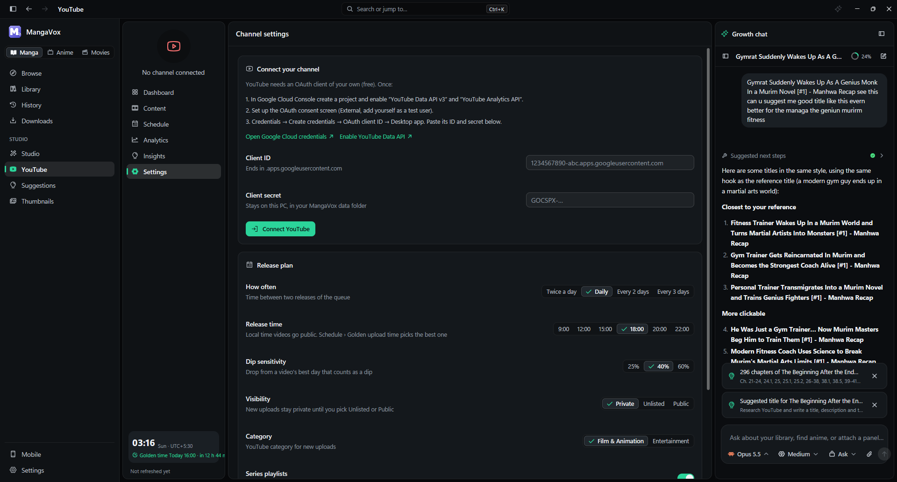

## AI providers

Studio and the assistant work with almost any AI you already have. Turn providers on in **Settings → AI providers**, add a key if one is needed, and test it. Pick the model per step (Read, Story and so on) or per chat.

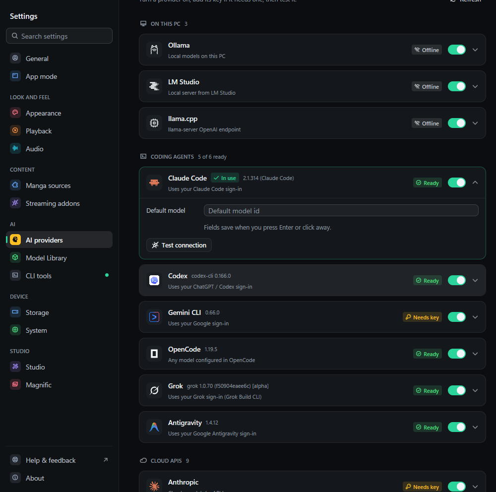

- **Coding agents (no API key needed)**: Claude Code, Codex, Gemini CLI, OpenCode, Grok and Antigravity. They use the sign-in you already have for that tool, so a Claude, ChatGPT or Google subscription is enough. The agents also get MangaVox's own tools over MCP, so they can search your sources, open pages and run Studio steps.
- **On this PC**: Ollama, LM Studio and llama.cpp. **Settings → Model Library** finds GGUF models on Hugging Face and sets them up in Ollama for you.
- **Cloud APIs**: Anthropic, OpenAI, Google Gemini, OpenRouter, Groq, DeepSeek, Mistral, xAI, or any OpenAI-compatible endpoint.

If one provider hits its usage limit, MangaVox shows when it resets so you can switch to another and keep going.

## Phone companion

Pair your phone from **Mobile** in the sidebar to browse your library and read downloaded chapters on your local network.

## Install

1. Download `MangaVox-Setup-<version>.exe` from the [latest release](https://github.com/memegyanfactory-gif/mangavox/releases/latest).
2. Run it. It installs per user to `%LOCALAPPDATA%\Programs\MangaVox` with no admin rights, adds Start Menu and Desktop shortcuts, and appears under **Settings → Apps** for uninstalling.
3. On first start, choose **Set up MangaVox** for a short guided setup, or **Start empty**.

**Requirements:** Windows 10 or 11 (64-bit). Studio also needs Python and FFmpeg (the setup screen checks both and installs the voice engine for you) plus an AI model: a signed-in coding agent, a local model, or a cloud API key. An NVIDIA graphics card makes narration and rendering much faster but is not required.

### Updates

The app checks for a new version on start and every 30 minutes. When one exists, the button above Settings reads **Update to v…**. Click it and the update installs in place, then MangaVox restarts. **Settings → About** has the same check. Every push to `main` publishes a new release.

## Your data

Everything stays on your PC, in `~/.mangavox` by default: settings, library database, downloads, Studio projects, caches, keys and logs. **Settings → Storage** can move it to another drive, show what uses space, and clear any part of it. Uninstalling keeps your data unless you delete it there first.

## Build from source

You need a recent stable Rust toolchain on Windows.

```bash
cd native
cargo build -p mangavox
target\debug\mangavox.exe
```

From the repository root, `npm run dev` builds and runs the app, `npm run build` makes a release build, and `npm test` runs the Rust tests (no npm packages are needed). `pwsh scripts/package.ps1` builds the installer and a portable zip into `dist/`.

Logs are JSON lines in `~/.mangavox/logs/`. See [docs/DEBUGGING.md](docs/DEBUGGING.md) for more.

### Project layout

| Path | What it holds |
|------|---------------|
| `native/app` | the `mangavox` executable: window, shell, tray, updater hooks |
| `native/crates/mv-*` | app logic with no UI: core, sources, plugins, media, AI, Studio, recap pipeline, music score, YouTube, torrent, updater |
| `native/crates/ui-*` | the GPUI screens: manga, media, player, Studio, YouTube, settings, assistant, phone, welcome |
| `native/docs/design` | design notes for each screen |
| `python/` | Studio workers: text-to-speech, OCR, captions, video rendering |
| `tests/` | Python tests for the video pipeline |
| `scripts/` | dev runner, packaging and the personal-data guard used by the git hooks |

The git hooks in `.githooks` block personal data (downloaded pages, media, databases, keys) from being committed. Turn them on once per clone with `git config core.hooksPath .githooks`.

## Acknowledgements

MangaVox stands on the work of many open-source projects and services. Thank you to everyone who builds and maintains them. Each project keeps its own license; names and trademarks belong to their owners.

### App and interface

| Project | Used for | License |
|---|---|---|
| [GPUI](https://github.com/zed-industries/zed) by Zed Industries | the GPU-accelerated UI framework the whole app is drawn with | Apache-2.0 |
| [gpui-component / gpui-kit](https://github.com/longbridge/gpui-component) by Longbridge | UI components on top of GPUI | Apache-2.0 |
| [Phosphor Icons](https://phosphoricons.com) | interface icons | MIT |
| [Lobe Icons](https://github.com/lobehub/lobe-icons) | AI provider logos | MIT |
| [Tokio](https://github.com/tokio-rs/tokio) | async runtime | MIT |
| [reqwest](https://github.com/seanmonstar/reqwest) | HTTP client | MIT / Apache-2.0 |
| [Serde](https://github.com/serde-rs/serde) | JSON and config files | MIT / Apache-2.0 |
| [rusqlite](https://github.com/rusqlite/rusqlite) and [SQLite](https://sqlite.org) | library database | MIT; SQLite is public domain |
| [image](https://github.com/image-rs/image) | cover and page images | MIT / Apache-2.0 |
| [scraper](https://github.com/rust-scraper/scraper) | reading HTML from built-in sources | ISC |
| [rquickjs](https://github.com/DelSkayn/rquickjs) and [QuickJS](https://bellard.org/quickjs/) | the plugin sandbox | MIT |
| [wry](https://github.com/tauri-apps/wry) and [tao](https://github.com/tauri-apps/tao) by Tauri | the hidden browser behind smart bypass | MIT / Apache-2.0 |
| [tray-icon](https://github.com/tauri-apps/tray-icon) | the system tray icon | MIT / Apache-2.0 |
| [axum](https://github.com/tokio-rs/axum) and [tower-http](https://github.com/tower-rs/tower-http) | the phone companion server | MIT |
| [mpv / libmpv](https://mpv.io) | the video player | LGPL-2.1+ / GPL-2.0+ |
| [rqbit / librqbit](https://github.com/ikatson/rqbit) | torrent streaming (vendored in `mv-torrent/vendor`) | Apache-2.0 |
| [rodio](https://github.com/RustAudio/rodio) and [hound](https://github.com/ruuda/hound) | audio playback and WAV files | MIT / Apache-2.0 |
| [RustySynth](https://github.com/sinshu/rustysynth) | the music score's SoundFont synthesizer | MIT |
| [GeneralUser GS](https://github.com/mrbumpy409/GeneralUser-GS) by S. Christian Collins | the optional orchestra SoundFont | GeneralUser GS License |
| [bhippi-Video-editor](https://github.com/memegyanfactory-gif/bhippi-Video-editor) | timeline, keymap, undo history and export presets ported into the Video editor | MIT |

The full list of Rust crates and their versions is in [`native/Cargo.lock`](native/Cargo.lock).

### Studio pipeline (Python)

| Project | Used for | License |
|---|---|---|
| [FFmpeg](https://ffmpeg.org) | rendering, encoding and joining videos | LGPL-2.1+ / GPL-2.0+ |
| [Kokoro-82M](https://huggingface.co/hexgrad/Kokoro-82M) by hexgrad, via [kokoro-onnx](https://github.com/thewh1teagle/kokoro-onnx) | the default narration voices | Apache-2.0 (model), MIT (kokoro-onnx) |
| [Chatterbox](https://github.com/resemble-ai/chatterbox) by Resemble AI | expressive narration | MIT |
| [Piper](https://github.com/OHF-Voice/piper1-gpl) | lightweight narration voices | GPL-3.0 |
| [PyTorch](https://pytorch.org) and [torchaudio](https://github.com/pytorch/audio) | running the voice models | BSD-3-Clause |
| [Hugging Face Transformers](https://github.com/huggingface/transformers) | model loading | Apache-2.0 |
| [ONNX Runtime](https://github.com/microsoft/onnxruntime) | fast local inference | MIT |
| [librosa](https://github.com/librosa/librosa), [soundfile](https://github.com/bastibe/python-soundfile) and [pyloudnorm](https://github.com/csteinmetz1/pyloudnorm) | audio analysis and loudness | ISC, BSD-3-Clause, MIT |
| [PaddleOCR](https://github.com/PaddlePaddle/PaddleOCR) and [manga-ocr](https://github.com/kha-white/manga-ocr) | offline text reading fallback | Apache-2.0 |
| [OpenCV](https://opencv.org), [Pillow](https://python-pillow.org) and [NumPy](https://numpy.org) | panel cropping and image work | Apache-2.0, MIT-CMU, BSD-3-Clause |
| [Inter](https://github.com/rsms/inter), [Anton](https://github.com/googlefonts/AntonFont), [Archivo Black](https://github.com/Omnibus-Type/ArchivoBlack), [DM Serif Display](https://github.com/googlefonts/dm-fonts), [Mukta](https://github.com/EkType/Mukta) and [Space Mono](https://github.com/googlefonts/spacemono) | caption fonts (see [`python/fonts/OFL.txt`](python/fonts/OFL.txt)) | SIL OFL 1.1 |

### AI models and tools

| Project | Used for | License |
|---|---|---|
| [Claude Code](https://github.com/anthropics/claude-code) by Anthropic | coding-agent provider | Anthropic terms |
| [Codex CLI](https://github.com/openai/codex) by OpenAI | coding-agent provider | Apache-2.0 |
| [Gemini CLI](https://github.com/google-gemini/gemini-cli) by Google | coding-agent provider | Apache-2.0 |
| [OpenCode](https://github.com/sst/opencode) | coding-agent provider | MIT |
| [Google Antigravity](https://antigravity.google) | coding-agent provider | Google terms |
| Grok Build CLI by xAI | coding-agent provider | xAI terms |
| [Ollama](https://github.com/ollama/ollama) | local models | MIT |
| [LM Studio](https://lmstudio.ai) | local models | LM Studio terms |
| [llama.cpp](https://github.com/ggml-org/llama.cpp) | local models | MIT |
| [Hugging Face Hub](https://huggingface.co) | the Model Library and voice model downloads | service terms |

### Data and services

| Service | Used for |
|---|---|
| [MangaDex](https://mangadex.org) | manga catalog through its public API |
| [AniList](https://anilist.co), [Jikan](https://jikan.moe) (MyAnimeList) and [Kitsu](https://kitsu.io) | anime details, schedules and artwork |
| [Cinemeta](https://github.com/Stremio/stremio-addon-sdk) (Stremio) | movie and series catalogs |
| [YouTube Data API v3 and YouTube Analytics API](https://developers.google.com/youtube) | the YouTube page, uploads and Suggestions |
| [Magnific](https://www.magnific.com) (formerly the Freepik API) | thumbnail image generation |
| [Mihon](https://github.com/mihonapp/mihon) / Tachiyomi extension format and the [Stremio addon protocol](https://github.com/Stremio/stremio-addon-sdk) | the plugin and addon formats MangaVox can install |

MangaVox is not affiliated with or endorsed by any of the projects or services above.

---

Made by Aayush Datta.
