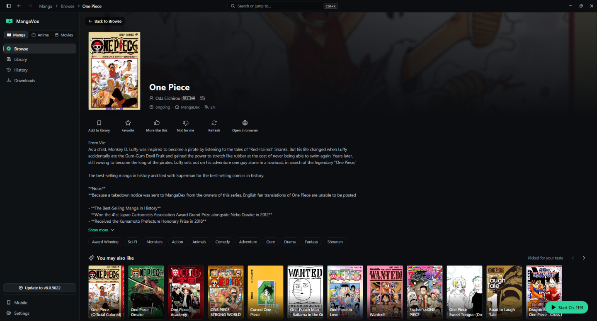
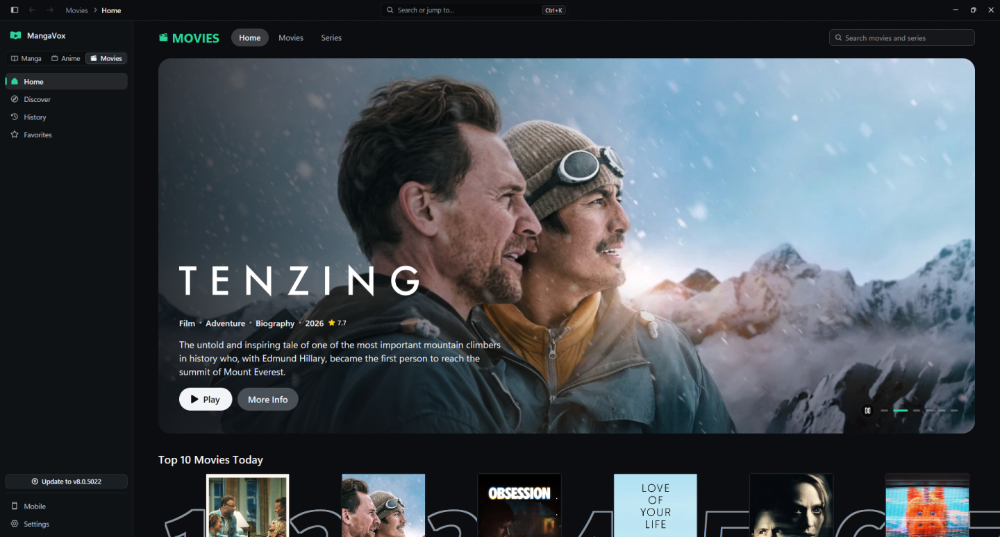
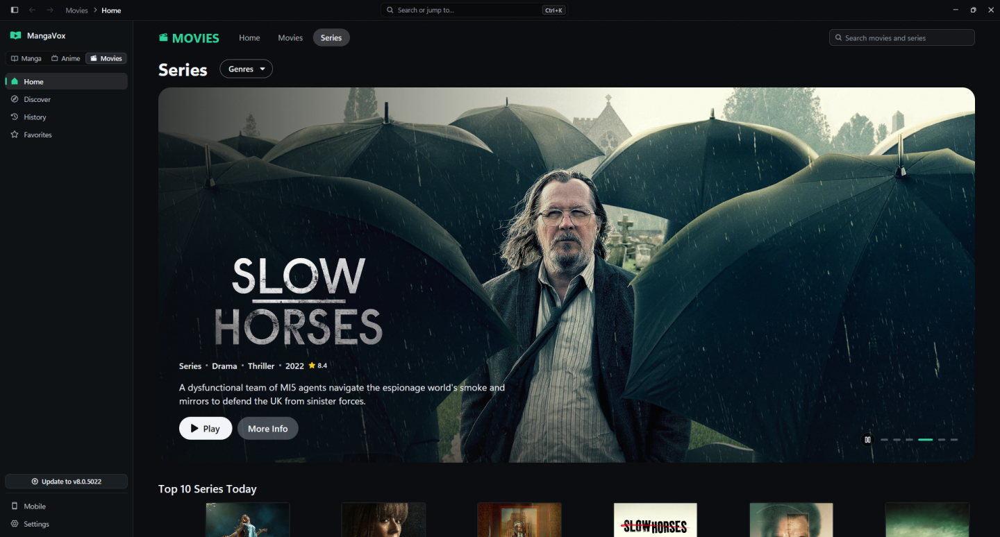
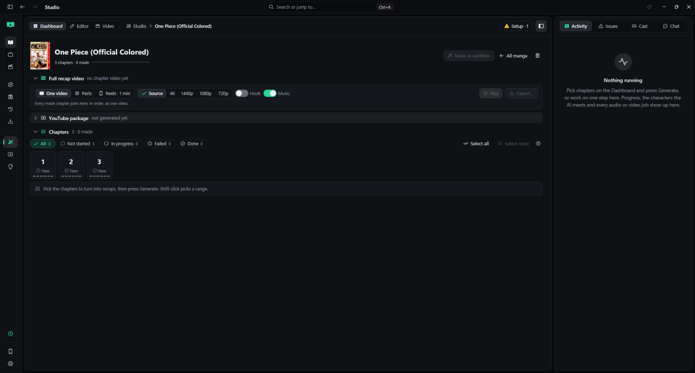
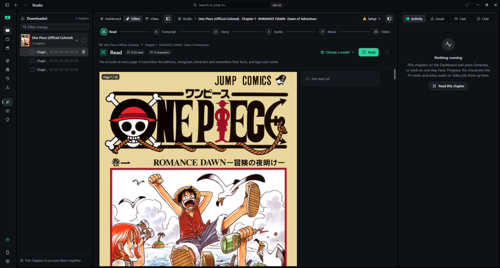

<p align="center">
  
</p>

<h1 align="center">MangaVox</h1>

<p align="center">
  A fast, native desktop app to read manga, watch movies and series, and turn manga chapters into narrated recap videos.
  <br>
  <a href="https://github.com/memegyanfactory-gif/mangavox/releases/latest"><b>Download for Windows</b></a>
</p>

---

MangaVox is written in Rust with the GPUI toolkit. It is a native app with no Electron and no web view for its interface. It starts quickly, stays light on memory and scrolls smoothly through long chapters and large libraries.

It has three areas in one window:

- **Manga**: browse, search, read, download and track manga from the sources you add.
- **Movies, series and anime**: catalogs, artwork, trailers and a built-in player, with playback through the addons you add.
- **Studio** (optional): an AI pipeline that reads a chapter, writes a script, narrates it and renders a recap video ready for YouTube.

## Screenshots

### Manga

A title page from a MangaDex source: details, tags, recommendations picked for your taste, and the chapter list merged across every source you have installed.



### Movies



### Series



### Studio

The Studio dashboard shows each manga you have downloaded, its chapters, and how far each one is through the pipeline.



The editor shows a chapter page by page (every page is numbered, for example "Page 1 / 55"). Each step has its own tab: Read, Transcript, Story, Audio, Music and Video.



## Sources, plugins and addons

**MangaVox ships empty.** A fresh install has no source, repository, plugin or addon installed or switched on. Browse stays empty until you add something yourself.

You can install whatever plugins, extensions, repositories and addons you choose:

- **Manga**: extension repositories in the Mihon / Tachiyomi format, single plugins from a GitHub or `manifest.json` link, and a few built-in site readers that stay hidden until you open them in Settings.
- **Movies, series and anime**: any Stremio-compatible addon, from a `manifest.json` or `stremio://` link.

Everything you install shows up right away, and you can remove any of it again from **Settings → Manga sources** or **Settings → Streaming addons**. Plugins run in a sandbox with memory and time limits.

MangaVox does not host, provide or recommend any content. You decide what to install, and you are responsible for using it in line with the laws of your country and the terms of the sites involved.

## Features

### Reading

- Popular, Latest and **For you** feeds per source, and one search across every source you have installed.
- Chapters for the same title are merged across all your sources under the best available name, so a chapter missing from one source is filled in from another.
- Chapter language filter (English, Spanish, Portuguese, French, Indonesian, Russian, Japanese or all), with a fallback to every language when a title has none in yours.
- Library, history, favorites, "more like this" / "not for me" taste signals, and offline chapter downloads.
- **Smart bypass**: when a site shows an anti-bot check, MangaVox passes it in a hidden built-in browser and loads the page again. It is on by default and can be switched off.

### Watching

- Movie and series home pages with top 10 lists, genres, artwork and trailers.
- A built-in player with subtitles and history, using the streams of the addons you install.

### Studio: manga to recap video

Turn on **Settings → App mode → Studio mode** to add Studio, YouTube and Suggestions to the sidebar.

1. **Read**: a vision model reads every page, transcribes the balloons in reading order, recognizes characters by face (it keeps a character memory across chapters), and tags each scene. Several pages are read at once and stored in order.
2. **Transcript**: edit the text page by page, or ask the AI about a page.
3. **Story**: the AI writes a recap script in your channel's style.
4. **Audio**: local text-to-speech narration (Kokoro by default, GPU-accelerated when available) with other engines optional.
5. **Music**: a soundtrack timed and ducked under the narration.
6. **Video**: panels with camera moves, transitions, captions and color looks are rendered with FFmpeg. Clips render in parallel and are joined into one video, parts, or vertical reels in source, 720p, 1080p, 1440p or 4K.

The **YouTube package** step drafts a title, description, tags and a hook. **Suggestions** watches trending manga recap videos and matches them to titles in your installed sources.

### Assistant

A chat panel that works with cloud APIs (Anthropic, OpenAI, Gemini, OpenRouter, Groq, DeepSeek, Mistral, xAI), local models (Ollama, LM Studio, llama.cpp) and coding-agent CLIs (Claude Code, Codex, Gemini CLI, OpenCode, Grok, Antigravity). CLI agents get the app's own tools over MCP, so they can search your sources, open pages and run Studio steps.

### Phone companion

Pair your phone from **Mobile** in the sidebar to browse your library and read downloaded chapters on your local network.

## Install

1. Download `MangaVox-Setup-<version>.exe` from the [latest release](https://github.com/memegyanfactory-gif/mangavox/releases/latest).
2. Run it. It installs per user to `%LOCALAPPDATA%\Programs\MangaVox` with no admin rights, adds Start Menu and Desktop shortcuts, and appears under **Settings → Apps** for uninstalling.
3. On first start, choose **Set up MangaVox** for a short guided setup, or **Start empty**.

**Requirements:** Windows 10 or 11 (64-bit). Studio also needs Python and FFmpeg (the setup screen checks both and installs the voice engine for you) plus an AI model: a cloud API key, a local model, or a signed-in CLI agent.

### Updates

The app checks for a new version on start and every 30 minutes. When one exists, the button above Settings reads **Update to v…**. Click it and the update installs in place, then MangaVox restarts. **Settings → About** has the same check. Every push to `main` publishes a new release.

## Your data

Everything stays on your PC, in `~/.mangavox` by default: settings, library database, downloads, Studio projects, caches and logs. **Settings → Storage** can move it to another drive, show what uses space, and clear any part of it. Uninstalling keeps your data unless you delete it there first.

## Build from source

You need a recent stable Rust toolchain on Windows.

```bash
cd native
cargo build -p mangavox
target\debug\mangavox.exe
```

From the repository root, `npm run dev` builds and runs the app, `npm run build` makes a release build, and `npm test` runs the Rust tests (no npm packages are needed). `pwsh scripts/package.ps1` builds the installer and a portable zip into `dist/`.

Logs are JSON lines in `~/.mangavox/logs/`. See [docs/DEBUGGING.md](docs/DEBUGGING.md) for more.

### Project layout

| Path | What it holds |
|------|---------------|
| `native/app` | the `mangavox` executable: window, shell, tray, updater hooks |
| `native/crates/mv-*` | app logic with no UI: core, sources, plugins, media, AI, Studio, recap pipeline, torrent, updater |
| `native/crates/ui-*` | the GPUI screens: manga, media, player, Studio, settings, assistant, phone, welcome |
| `native/docs/design` | design notes for each screen |
| `python/` | Studio workers: text-to-speech, captions, video rendering |
| `tests/` | Python tests for the video pipeline |
| `scripts/` | dev runner, packaging and the personal-data guard used by the git hooks |

The git hooks in `.githooks` block personal data (downloaded pages, media, databases, keys) from being committed. Turn them on once per clone with `git config core.hooksPath .githooks`.

---

Made by Aayush Datta.
